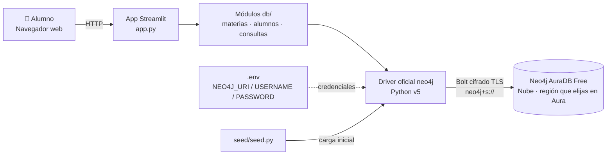
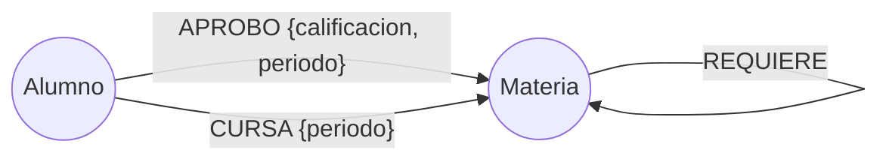

# Esqueleto del PDF — Mapa de Materias con Neo4j AuraDB

> Sigue **exactamente** el orden obligatorio del profesor (5 secciones). Extensión sugerida: 8–12 páginas con portada.
> Lo que está entre [corchetes] lo llenas tú; el resto ya es un borrador que puedes usar o ajustar.

---

## Portada
- Universidad Anáhuac Mayab · Bases de Datos Avanzadas
- **Mapa de Materias: grafo de prerrequisitos en Neo4j AuraDB**
- Emilio [apellidos] · [matrícula] · Profesor: [nombre] · [fecha]
- Enlace al repositorio: [URL]

---

## 1. Introducción y dominio del problema (≈1 página)

**Contexto.** Cada semestre los alumnos arman su horario revisando a mano el plan de estudios para saber qué materias pueden inscribir. Los prerrequisitos forman **cadenas**: para llegar a *Proyecto Terminal* hay que aprobar *Cómputo en la Nube*, que requiere *Desarrollo Web*, que requiere *Bases de Datos Avanzadas*… Un error en esa revisión retrasa la graduación un semestre completo.

**Caso de uso.** Una aplicación que guarda el plan de estudios y el historial de cada alumno en una base de datos de grafo en la nube y responde al instante:
1. ¿Qué materias puedo cursar ya?
2. ¿Qué me falta para llegar a una materia?
3. ¿Qué materias se desbloquean si apruebo una?
4. ¿Cuántos semestres mínimos me faltan (ruta crítica)?
5. ¿Qué compañeros llevan mis mismas materias?

**Usuarios.** Alumnos y coordinadores académicos.

**Alcance.** CRUD de materias, prerrequisitos y alumnos; consultas de recorrido de grafo; datos de ejemplo de un plan de 8 semestres con 22 materias y 4 alumnos.

---

## 2. Justificación del paradigma (≈2 páginas) — *15% de la nota*

**Idea central (dilo así en la defensa):** *el problema es una red de dependencias de profundidad desconocida. En un grafo, seguir una relación cuesta lo mismo sin importar cuántos datos haya (index-free adjacency); en SQL, cada nivel de la cadena es un JOIN más.*

### 2.1 La misma pregunta en SQL y en Cypher

"Todos los prerrequisitos de Proyecto Terminal, a cualquier profundidad":

**SQL (relacional)** — tabla puente `prerrequisito(materia, requisito)` y CTE recursiva:
```sql
WITH RECURSIVE cadena AS (
    SELECT requisito FROM prerrequisito WHERE materia = 'TES801'
  UNION
    SELECT p.requisito
    FROM prerrequisito p
    JOIN cadena c ON p.materia = c.requisito
)
SELECT m.clave, m.nombre
FROM cadena c JOIN materia m ON m.clave = c.requisito;
```

**Cypher (grafo):**
```cypher
MATCH (:Materia {clave: 'TES801'})-[:REQUIERE*1..]->(req)
RETURN DISTINCT req.clave, req.nombre;
```

### 2.2 Tabla comparativa

| Aspecto | Relacional (SQL) | Grafo (Neo4j) |
|---|---|---|
| Representación de prerrequisitos | Tabla puente + llaves foráneas | Relación `REQUIERE` de primera clase |
| Cadenas de profundidad variable | CTE recursiva, difícil de leer y optimizar | `*1..` en una línea |
| Costo por nivel de profundidad | Un JOIN más por nivel (crece con el tamaño de las tablas) | Seguir punteros entre nodos vecinos (constante por salto) |
| Camino más corto / ruta crítica | No hay operador nativo; requiere programación | `shortestPath`, `length(ruta)` nativos |
| Detección de ciclos | Lógica en triggers o en la app | `NOT EXISTS { (r)-[:REQUIERE*]->(m) }` |
| Cambios de esquema (nuevo tipo de relación, p. ej. `EQUIVALE_A`) | `ALTER TABLE` / nuevas tablas | Agregar la relación, sin migración |
| Legibilidad para el negocio | Hay que traducir JOINs | El diagrama del dominio *es* el modelo |

### 2.3 ¿Por qué no Clave-Valor?
Redis o DynamoDB son excelentes para buscar por clave, pero **no saben recorrer relaciones**: para encontrar la cadena de prerrequisitos habría que traer clave por clave desde la aplicación (N viajes de red). El valor del problema está en las relaciones, no en los registros aislados.

### 2.4 Cuándo SQL sí sería mejor (muestra criterio)
Para reportes tabulares (kárdex, sumas de créditos, actas de calificaciones) SQL es igual o mejor. En una universidad real convivirían: SQL para control escolar y grafo para planeación académica.

---

## 3. Arquitectura de la solución (≈1 página)

**Diagrama de bloques** (pégalo en mermaid.live y exporta PNG):



**Explicación por capa (un párrafo cada una):**
- **Cliente/Backend:** Streamlit sirve la interfaz y ejecuta la lógica en Python; `app.py` no contiene Cypher, solo llama funciones.
- **Acceso a datos:** módulos `db/` con consultas parametrizadas (evitan inyección de Cypher).
- **SDK de conexión:** driver oficial `neo4j`; un solo `Driver` con pool de conexiones, `execute_query` con reintentos automáticos ante fallas transitorias.
- **Base de datos en la nube:** AuraDB Free, servicio DaaS gestionado por Neo4j (respaldos, parches y TLS a cargo del proveedor).
- **Seguridad:** credenciales en variables de entorno (`.env` excluido de git); conexión cifrada con `neo4j+s`.

---

## 4. Diseño del modelo NoSQL (≈2 páginas) — *20% de la nota*

### 4.1 Diagrama del grafo del dominio
(Captura de Neo4j Browser con `CALL db.schema.visualization()` y otra con `MATCH p=(:Materia)-[:REQUIERE]->() RETURN p`.)



### 4.2 Nodos (Labels)

| Label | Propiedad | Tipo | Notas |
|---|---|---|---|
| Materia | clave | String | Única (constraint) — ej. `BD401` |
| | nombre | String | |
| | semestre | Integer | Semestre sugerido en el plan |
| | creditos | Integer | |
| | area | String | Matemáticas, Programación, etc. |
| Alumno | matricula | String | Única (constraint) |
| | nombre | String | |
| | carrera | String | |

### 4.3 Relaciones

| Tipo | Dirección | Propiedades | Cardinalidad |
|---|---|---|---|
| REQUIERE | Materia → Materia (la que se cursa → su prerrequisito) | — | N:M, sin ciclos |
| APROBO | Alumno → Materia | calificacion (Float), periodo (String) | N:M |
| CURSA | Alumno → Materia | periodo (String) | N:M |

### 4.4 Decisiones de diseño (buenas prácticas)
- Labels en PascalCase y relaciones en MAYÚSCULAS con verbo (convención de Neo4j).
- La **calificación vive en la relación** `APROBO`, no en el nodo: es un dato del vínculo alumno–materia.
- **Constraints de unicidad** en `clave` y `matricula` (además crean índice para búsquedas rápidas).
- Dirección de `REQUIERE` siempre hacia el prerrequisito; las consultas inversas usan `<-`.
- Se impide crear ciclos de prerrequisitos (consulta C6).
- `CURSA` y `APROBO` separados: al aprobar se borra `CURSA` (C13) para no duplicar estado.

---

## 5. Catálogo de consultas (≈3 páginas)

Copia las consultas **C1–C13** y **Q1–Q8** tal cual están en `CLAUDE.md` (son las mismas que ejecuta el código). Para cada una pon:

| Campo | Ejemplo |
|---|---|
| ID y nombre | Q1 — ¿Qué puedo cursar? |
| Propósito | Lista las materias cuyos prerrequisitos ya aprobó el alumno. |
| Patrón de grafo | Subconsulta `EXISTS` sobre vecinos `REQUIERE` |
| Código Cypher | (bloque de código) |
| Parámetros | `$matricula = 'A002'` |
| Resultado de ejemplo | Captura de la tabla en la app |

Agrupa así:
1. **CRUD Materias:** C1–C7
2. **CRUD Alumnos:** C8–C13
3. **Traversals:** Q1, Q2, Q3, Q4
4. **Búsqueda de caminos:** Q5 (ruta crítica), Q6 (shortestPath)
5. **Vecindades y análisis:** Q7 (compañeros a 2 saltos), Q8 (cuellos de botella)

Agrega también el **método del SDK** usado (fragmento de Python):
```python
records, summary, keys = driver.execute_query(
    QUERY_MATERIAS_DISPONIBLES,
    matricula=matricula,
    database_=DATABASE,
)
return [r.data() for r in records]
```

---

## Conclusiones (½ página, opcional pero suma)
- Qué aprendiste del modelo de grafo.
- Limitaciones: AuraDB Free (límite de nodos/relaciones, se pausa por inactividad).
- Mejoras futuras: relación `EQUIVALE_A` para revalidaciones, recomendación de carga semestral óptima.

## Referencias
- Documentación de Neo4j Cypher Manual y Python Driver Manual.
- Documentación de Neo4j AuraDB.
- [Plan de estudios oficial de tu carrera, si lo usas]

---

# Anexo para ti (no va en el PDF): preguntas probables en la defensa

| Pregunta | Respuesta corta |
|---|---|
| ¿Por qué grafo y no SQL? | Cadenas de prerrequisitos de profundidad variable: en SQL son CTE recursivas con un JOIN por nivel; en Cypher son `*1..` y cada salto es seguir un puntero (index-free adjacency). |
| ¿Cómo te conectas? | Driver oficial `neo4j` con protocolo Bolt sobre TLS (`neo4j+s://`), credenciales desde variables de entorno con `python-dotenv`. |
| ¿Qué hace `execute_query`? | Abre una sesión del pool, ejecuta en una transacción administrada y reintenta automáticamente errores transitorios. |
| ¿Por qué parametrizas? | Seguridad (evita inyección) y rendimiento (Neo4j cachea el plan de ejecución de la consulta). |
| ¿Neo4j es ACID? | Sí, las transacciones son ACID. AuraDB Free es una sola instancia, así que la lectura es consistente inmediatamente después de escribir. |
| ¿Qué pasa con el rendimiento si crece? | El costo depende de cuántos nodos recorres, no del total de la base. Los constraints crean índices para encontrar el nodo inicial rápido. |
| ¿Cómo evitas datos duplicados? | Constraints de unicidad en `clave` y `matricula`; `MERGE` en relaciones. |
| ¿Qué pasa si hay un ciclo de prerrequisitos? | C6 lo impide: solo crea la relación si no existe ya un camino de regreso. |
| ¿Qué es `DETACH DELETE`? | Borra el nodo y todas sus relaciones; sin `DETACH` Neo4j no deja borrar nodos conectados. |
| ¿Dónde está alojada la base? | Neo4j AuraDB Free, servicio gestionado (DaaS) en la nube (proveedor y región que aparecen en la consola de Aura). |
